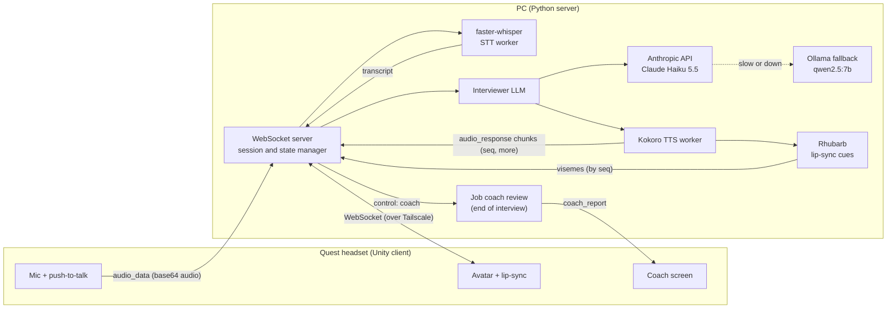

# VR Interview Simulator

## What it is and why

This is a VR job-interview practice simulator. The user sits in a virtual conference room and answers spoken questions from an AI interviewer. When the interview ends, an AI job coach gives feedback on each answer.

The idea is simple: practice speaking an interview answer out loud, in a realistic setting, before the real one.

**Try it in a browser:** a scripted web demo (no AI, no server) is at https://williamthe5thc.github.io/vr-interview-demo/. Best on desktop Chrome or Edge.

## Status

In progress (2026).

This repository holds the full Unity project and the server code, and it builds.
The only thing you add yourself is the Microsoft Rocketbox avatars, which a script downloads (see "Avatars" below).

- **Just want to try it on a Quest?** See [docs/INSTALL_QUEST.md](docs/INSTALL_QUEST.md).
- **Working on the code (or using Claude Code)?** Start with [CLAUDE.md](CLAUDE.md).

## What works today

Verified on a Meta Quest 1 headset in October 2026:

- A conference-room scene with 11 rotating interviewer avatars (Microsoft Rocketbox) and 7 job types, including software engineer, nurse, teacher, restaurant server, customer service and speech therapist.
- Push-to-talk speech.
- Speech-to-text with faster-whisper (large-v3-turbo).
- An AI interviewer using Claude Haiku 5.5 through the Anthropic API. A local Ollama model (qwen2.5:7b) takes over automatically when the API is slow or unavailable.
- Kokoro text-to-speech with Rhubarb lip-sync.
- Interviewer eye gaze, blinks, head nods and breathing.
- An AI job coach that scores each answer and gives specific feedback.
- Interview export to Markdown and JSON.
- About 2 seconds from the end of the user's answer to the interviewer's first word.
- The headset connects to the PC server over a private Tailscale network.
- A sign-in screen on the headset: each player types a personal access code (never built into the app), and can point the app at their own server under "Advanced". The app sends a sign-in (`auth`) message first; see [docs/PROTOCOL.md](docs/PROTOCOL.md).

## In progress

- Bare-hand tracking with pinch input (OpenXR + XR Hands). It works in a separate test build.
- A blind comparison of local and hosted language models, rated by people.
- A prototype of a second practice scenario: a parent and child conversation (`server/app/parent_child/`).

## Architecture

Short version of the message contract (every message is in [docs/PROTOCOL.md](docs/PROTOCOL.md); design notes in [docs/architecture.md](docs/architecture.md)):

- The first message is `auth` with the player's access code. The server answers `auth_result` (accepted, with interviews left today, or refused with a reason) before anything else.

- The headset sends the recorded answer as an `audio_data` message with base64 audio.
- The server replies with `audio_response` messages. Each one is a short WAV chunk. A chunk has a `seq` number, and `more: true` when another chunk of the same reply follows.
- Mouth shapes arrive in a separate `visemes` message with the same `seq`, so playback can start before the lip-sync cues are ready.
- The headset sends `control` messages with an action such as `begin`, `stop`, `reset`, `coach` or `timeout`.
- At the end of an interview the server saves an export and sends `export_saved`. The coach runs as a separate review step when the headset asks for it with `control: coach`.

## Tech stack

- Unity 2022.3 (built-in render pipeline, Android / Meta Quest), C#
- Python 3, websockets
- faster-whisper (speech-to-text)
- Ollama (local language model) and the Anthropic API (hosted language model)
- Kokoro (text-to-speech), through kokoro-onnx
- Rhubarb Lip Sync (mouth shapes)
- Microsoft Rocketbox avatars
- Tailscale or a Cloudflare tunnel between headset and PC; NativeWebSocket (Apache-2.0) in the client

Unity packages are listed in `unity/Packages/manifest.json`. The editor version is 2022.3.7f1 (`unity/ProjectSettings/ProjectVersion.txt`).

## Repository layout

- `unity/`: the Unity project (Assets, Packages, ProjectSettings). `unity/Assets/Editor/` has the scripts that build the scene (`ConferenceInterviewSceneBuilder.cs`) and the APK (`QuestBuild.cs`).
- `server/`: the Python server, the speech-to-text and text-to-speech workers, access codes, and the example config.
- `scripts/`: PowerShell scripts to start and stop the servers and to switch the language model, interviewer mode, coach and voice.
- `tools/`: `get_rocketbox.ps1` / `get_rocketbox.sh` (avatar download) and the Blender scripts that made the room props.
- `docs/`: [PROTOCOL.md](docs/PROTOCOL.md), [INSTALL_QUEST.md](docs/INSTALL_QUEST.md), architecture notes and media.
- `third_party/`: licences for third-party material.

## How to build and run

Full steps are in [CLAUDE.md](CLAUDE.md). In short:

1. Install Git LFS and Unity 2022.3.7f1 with Android Build Support.
2. **Before opening Unity**, download the avatars: `tools\get_rocketbox.ps1` (Windows) or `tools/get_rocketbox.sh`.
3. Build the APK in batch mode with `-executeMethod QuestBuild.BuildConference`, or open `unity/` in the Editor.
4. Run the server on a Windows PC with your own Anthropic key (user environment variable `VRSIM_ANTHROPIC_API_KEY`) or a free local Ollama model. Then start it with `scripts\start_servers.ps1`.
5. Install the APK on the headset and type your server's address under "Advanced" on the sign-in screen ([docs/INSTALL_QUEST.md](docs/INSTALL_QUEST.md)).

### Avatars and store assets

- The interviewers are Microsoft Rocketbox "Business" characters (MIT). They aren't committed. The download scripts fetch them from a pinned upstream commit into the place where the project expects them.
- The scene also refers to two Unity Asset Store packs that can't be redistributed: Sunbox Games' *Stylized Customizable Avatar* (an old, hidden placeholder avatar) and nappin's *Office Props Softpack* (one mug).
  The app builds and runs without them. Import them from your own Asset Store account if you have them.

## Privacy

Interview audio is not stored. Transcripts and exports stay on the server machine and are never committed to this repository.
On the project owner's test server, transcripts are kept so the project can be improved; players are told this. The API key is read from an environment variable and is never logged or written to disk by the server.

## Media

Scripted web demo: https://williamthe5thc.github.io/vr-interview-demo/. Headset demo video: coming soon. Images marked "editor capture" come from the Unity editor, not the headset.

| | |
|---|---|
|  |  |
| Title screen with job choice (editor capture) | Conference room (editor capture) |

## Licence

MIT: see [LICENSE](LICENSE). Third-party material (Rocketbox avatars, Asset Store packs, textures) keeps its own licence and is listed in [NOTICE.md](NOTICE.md).
