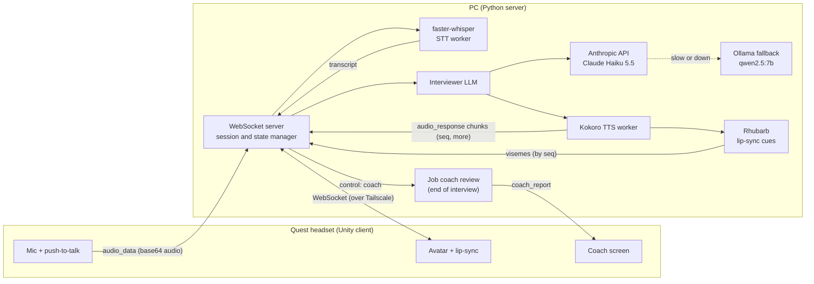
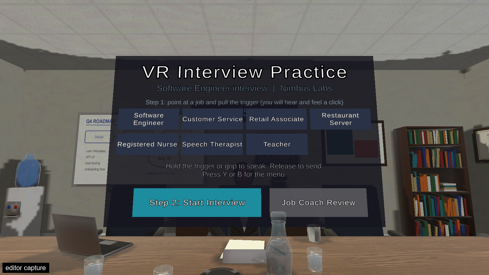
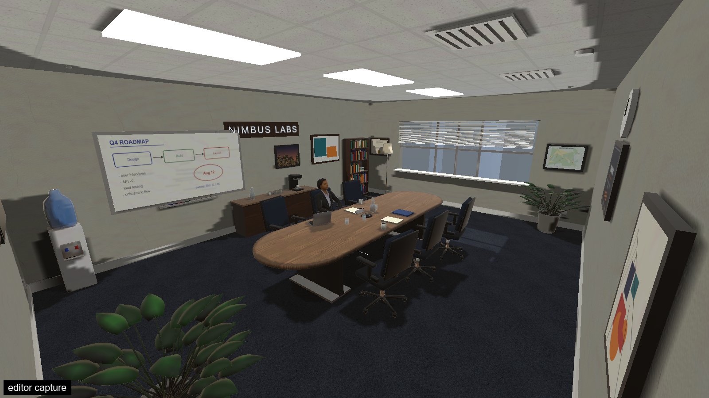

# VR Interview Simulator

## What it is and why

This is a VR job-interview practice simulator. The user sits in a virtual conference room and answers spoken questions from an AI interviewer. When the interview ends, an AI job coach gives feedback on each answer.

The idea is simple: practice speaking an interview answer out loud, in a realistic setting, before the real one.

**Try it in a browser:** a scripted web demo (no AI, no server) is at https://williamthe5thc.github.io/vr-interview-demo/. Best on desktop Chrome or Edge.

## Status

In progress (2026).

This repository is a code snapshot for people who want to read the project. It does not include the 3D scenes, models or avatars, so the Unity project will not open as a finished scene from this repository alone.

## What works today

Verified on a Meta Quest 1 headset in October 2026:

- A conference-room scene with 11 rotating interviewer avatars (Microsoft Rocketbox) and 7 job types, including software engineer, nurse, teacher, restaurant server, customer service and speech therapist.
- Push-to-talk speech.
- Speech-to-text with faster-whisper (large-v3-turbo).
- An AI interviewer using Claude Haiku 5.5 through the Anthropic API. A local Ollama model (qwen2.5:7b) takes over automatically when the API is slow or unavailable.
- Kokoro text-to-speech with Rhubarb lip-sync.
- Interviewer eye gaze, blinks, head nods and breathing.
- An AI job coach that scores each answer and gives specific feedback.
- Interview export to Markdown and JSON.
- About 2 seconds from the end of the user's answer to the interviewer's first word.
- The headset connects to the PC server over a private Tailscale network.

## In progress

- Bare-hand tracking with pinch input (OpenXR + XR Hands). It works in a separate test build.
- A blind comparison of local and hosted language models, rated by people.
- A prototype of a second practice scenario: a parent and child conversation (`server/app/parent_child/`).

## Architecture

Short version of the message contract (details in [docs/architecture.md](docs/architecture.md)):

- The headset sends the recorded answer as an `audio_data` message with base64 audio.
- The server replies with `audio_response` messages. Each one is a short WAV chunk. A chunk has a `seq` number, and `more: true` when another chunk of the same reply follows.
- Mouth shapes arrive in a separate `visemes` message with the same `seq`, so playback can start before the lip-sync cues are ready.
- The headset sends `control` messages with an action such as `begin`, `stop`, `reset`, `coach` or `timeout`.
- At the end of an interview the server saves an export and sends `export_saved`. The coach runs as a separate review step when the headset asks for it with `control: coach`.

## Tech stack

- Unity 2022.3 (built-in render pipeline, Android / Meta Quest), C#
- Python 3, websockets
- faster-whisper (speech-to-text)
- Ollama (local language model) and the Anthropic API (hosted language model)
- Kokoro (text-to-speech), through kokoro-onnx
- Rhubarb Lip Sync (mouth shapes)
- Microsoft Rocketbox avatars
- Tailscale (private network between headset and PC)

Unity packages are listed in `client/manifest.json`. The editor version is in `client/ProjectVersion.txt` (2022.3.7f1).

## Repository layout

- `client/`: Unity C# scripts. `client/Editor/` has the editor scripts that build the scene and the Quest build.
- `server/`: the Python server, the speech-to-text and text-to-speech workers, and the config.
- `scripts/`: PowerShell scripts to start and stop the servers and to switch the language model, interviewer mode and voice.
- `docs/`: architecture notes and media.
- `third_party/`: licences for third-party material.

## How to run

This is an honest outline, not a one-command install. It was built for one Windows PC with an NVIDIA GPU and a Quest headset.

Requirements:

- Windows PC with an NVIDIA GPU, Python 3, and Ollama with `qwen2.5:7b-instruct` pulled.
- Tailscale on the PC and on the headset (or the same local network).
- Unity 2022.3 with Android build support, for the client.

Server:

1. Create the virtual environments the start script expects inside `server/`: `.venv` (main server), `.venv_fw` (see `server/requirements-stt-worker.txt`) and `.venv_tts` (see `server/requirements-tts-worker.txt`). The main `server/requirements.txt` is older and may be out of date.
2. Download Rhubarb Lip Sync 1.14.0 (see `server/tools/README_rhubarb.md`). Without it the server still works, and the headset uses a loudness-based mouth.
3. Download the Kokoro model and voice files into `server/models/kokoro/`.
4. To use the hosted model, set the environment variable `VRSIM_ANTHROPIC_API_KEY` to your own Anthropic API key. Never commit it. Without it, replies use the local model.
5. Start everything with `scripts/start_servers.ps1` and stop it with `scripts/stop_servers.ps1`. The other `scripts/switch_*.ps1` files change the language model, interviewer mode, coach mode and voice engine.

Client:

1. Open the Unity project in Unity 2022.3 and set up the scene. The avatars are not included. Download them separately from [github.com/microsoft/Microsoft-Rocketbox](https://github.com/microsoft/Microsoft-Rocketbox) (MIT licence) and place them under `Assets/Rocketbox`. The licence text is in `third_party/Microsoft-Rocketbox-LICENSE`.
2. Put your server addresses in the client. The scripts contain the placeholders `YOUR_PC_TAILSCALE_IP` and `YOUR_PC_LAN_IP`. They are set per install. The scene builder in `client/Editor/ConferenceInterviewSceneBuilder.cs` holds the default list.
3. Build for Android with the Quest build script in `client/Editor/QuestBuild.cs`.

## Privacy

Interview audio is not stored. Transcripts and exports stay on the local machine and are excluded from this repository. The API key is read from an environment variable and is never logged or written to disk by the server.

## Media

Scripted web demo: https://williamthe5thc.github.io/vr-interview-demo/. Headset demo video: coming soon. Images marked "editor capture" come from the Unity editor, not the headset.

| | |
|---|---|
|  |  |
| Title screen with job choice (editor capture) | Conference room (editor capture) |

## Licence

No licence has been chosen yet. All rights reserved until one is. See [NOTICE.md](NOTICE.md).
