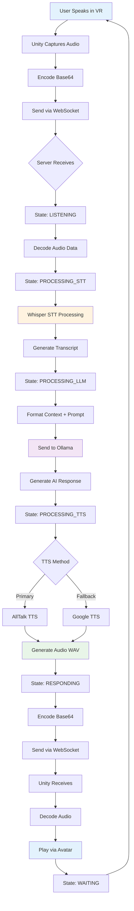
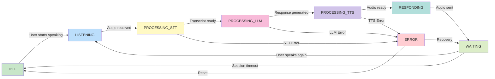
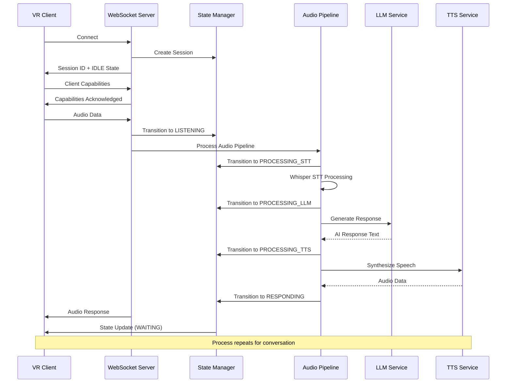
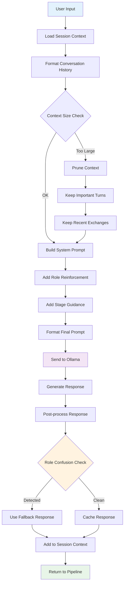
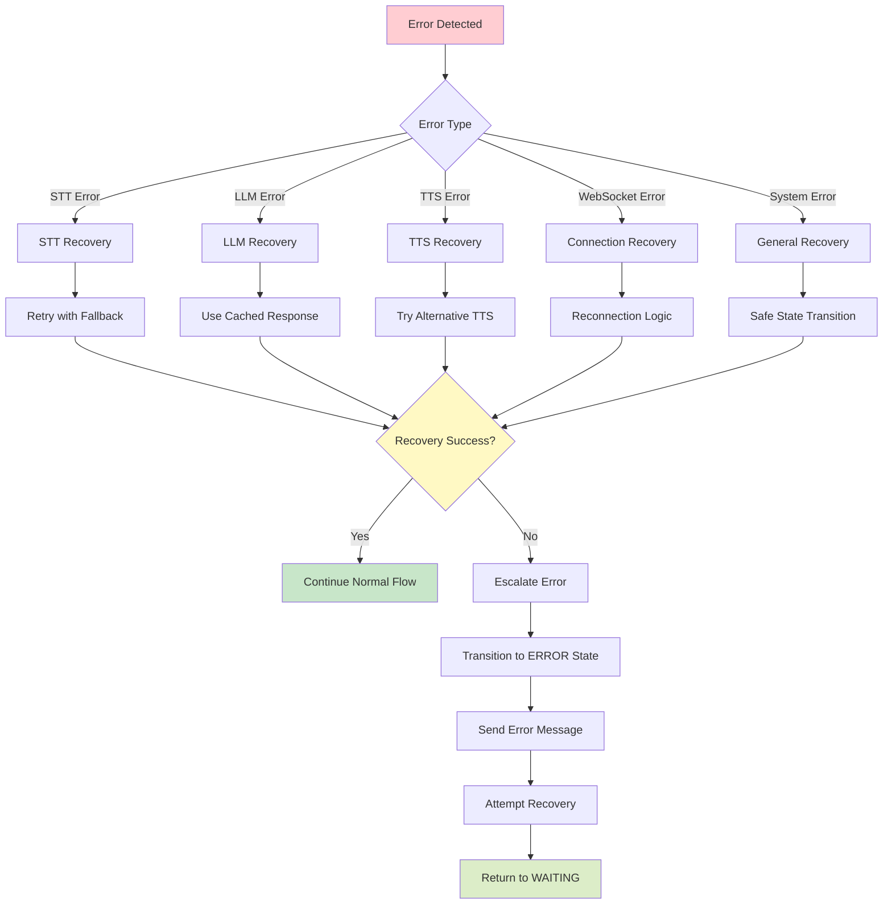
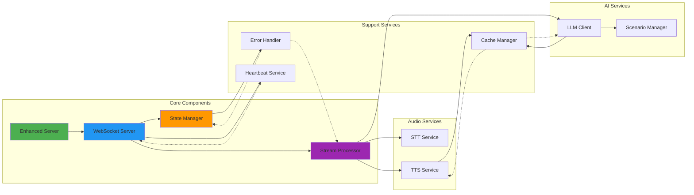

# 📊 VR Interview System - Architecture Flowcharts

## 🏗️ System Architecture Overview

```mermaid
graph TB
    subgraph "VR Client (Unity)"
        A[VR Headset] --> B[Unity Application]
        B --> C[WebSocket Client]
        B --> D[Audio Capture]
        B --> E[Avatar System]
        B --> F[UI System]
    end
    
    subgraph "Network Layer"
        G[WebSocket Connection<br/>Port 8765]
    end
    
    subgraph "Python Server"
        H[Enhanced Server] --> I[WebSocket Server]
        I --> J[State Manager]
        I --> K[Stream Processor]
        
        subgraph "Audio Services"
            L[STT Service<br/>(Whisper)]
            M[TTS Service<br/>(AllTalk/gTTS)]
        end
        
        subgraph "AI Services"
            N[LLM Client<br/>(Ollama)]
            O[Scenario Manager]
        end
        
        subgraph "Support Services"
            P[Error Handler]
            Q[Heartbeat Service]
            R[Cache Manager]
        end
    end
    
    subgraph "External Services"
        S[Ollama Server<br/>(Mistral LLM)]
        T[AllTalk TTS Server]
        U[CUDA/Whisper STT]
    end
    
    C -.->|WebSocket| G
    G -.->|WebSocket| I
    
    K --> L
    K --> M
    K --> N
    
    L --> U
    M --> T
    N --> S
    
    J --> P
    I --> Q
    N --> R
    
    style A fill:#e1f5fe
    style H fill:#c8e6c9
    style S fill:#fff3e0
    style T fill:#fff3e0
    style U fill:#fff3e0
```

## 🔄 Audio Processing Pipeline



## 🎯 State Machine Flow



## 🌐 WebSocket Communication Flow



## 🧠 LLM Context Management



## 🔧 Error Handling & Recovery



## 🏭 Production Architecture

```mermaid
graph TB
    subgraph "Client Layer"
        A[Oculus Quest VR]
        B[Unity Application]
    end
    
    subgraph "Network & Security"
        C[WebSocket SSL/TLS]
        D[Firewall Rules]
        E[Load Balancer]
    end
    
    subgraph "Application Layer"
        F[VR Interview Server]
        G[Session Management]
        H[Audio Processing]
        I[State Management]
    end
    
    subgraph "Service Layer"
        J[Ollama LLM Service]
        K[AllTalk TTS Service]
        L[Whisper STT Service]
    end
    
    subgraph "Infrastructure"
        M[GPU Server<br/>(CUDA)]
        N[CPU Server<br/>(Processing)]
        O[Storage<br/>(Conversations)]
    end
    
    subgraph "Monitoring"
        P[Health Checks]
        Q[Performance Metrics]
        R[Error Logging]
    end
    
    A --> B
    B --> C
    C --> D
    D --> E
    E --> F
    
    F --> G
    F --> H
    F --> I
    
    H --> J
    H --> K
    H --> L
    
    J --> M
    K --> N
    L --> M
    
    G --> O
    
    F --> P
    F --> Q
    F --> R
    
    style A fill:#e1f5fe
    style F fill:#c8e6c9
    style M fill:#fff3e0
    style P fill:#f3e5f5
```

## 📱 Component Interaction Matrix



---

## 📋 Flowchart Usage Guide

### For README.md Integration
These flowcharts are designed to be embedded in your GitHub README to help users understand:

1. **System Architecture** - Overall system structure and components
2. **Audio Pipeline** - How voice processing works end-to-end  
3. **State Machine** - Valid state transitions and error handling
4. **WebSocket Flow** - Client-server communication protocol
5. **LLM Context** - How AI conversations are managed
6. **Error Recovery** - How the system handles failures
7. **Production Setup** - Deployment architecture considerations

### Customization Notes
- All diagrams use Mermaid syntax for GitHub compatibility
- Color coding helps distinguish component types
- Arrows show data flow and dependencies
- Subgraphs group related functionality
- Decision diamonds show branching logic

### Integration Tips
1. Add these to your main README.md file
2. Use appropriate section headers
3. Include brief explanations for each diagram
4. Link to detailed documentation for complex flows
5. Update diagrams when architecture changes

These flowcharts provide a **visual overview** that makes your sophisticated VR Interview System immediately understandable to developers, users, and contributors! 🎉
