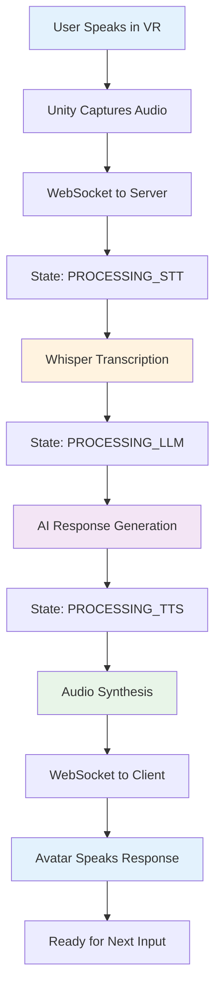
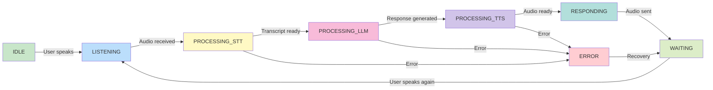
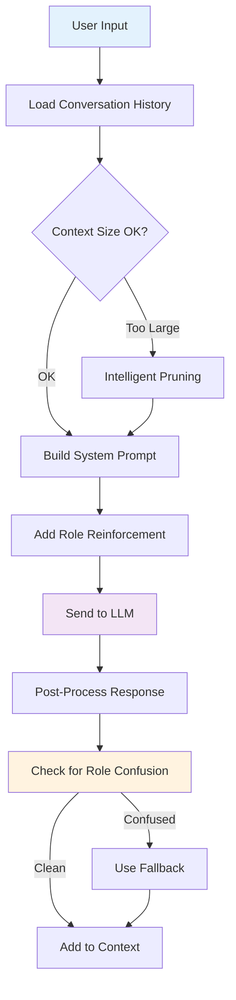
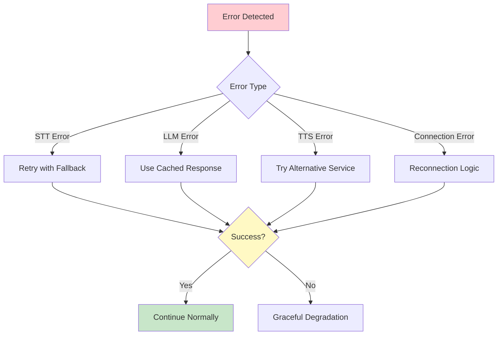

# 🎤 VR Interview System

> **AI-Powered Virtual Reality Interview Practice Platform**

Experience realistic job interviews in VR with an intelligent AI interviewer that provides natural conversation, contextual follow-up questions, and professional feedback.

[](https://github.com/yourusername/vr-interview-system)
[](https://python.org)
[](https://unity.com)
[](https://developer.mozilla.org/en-US/docs/Web/API/WebSockets_API)

## 🎯 Features

- **🎭 Intelligent AI Interviewer** - Professional AI that acts as hiring manager, not candidate
- **🎧 High-Quality Audio** - GPU-accelerated speech recognition and natural text-to-speech
- **🔄 Real-Time Processing** - WebSocket-based communication with live state updates
- **💬 Context-Aware Conversations** - AI remembers and builds upon previous responses
- **🛡️ Robust Error Handling** - Multiple fallback mechanisms for reliable operation
- **📊 Professional Scenarios** - Configurable interview types and difficulty levels

## 🏗️ System Architecture

```mermaid
graph TB
    subgraph "VR Client (Unity)"
        A[VR Headset] --> B[Unity Application]
        B --> C[WebSocket Client]
        B --> D[Audio Capture]
        B --> E[Avatar System]
    end
    
    subgraph "Python Server"
        F[Enhanced Server] --> G[WebSocket Server]
        G --> H[State Manager]
        G --> I[Stream Processor]
        
        subgraph "Audio Services"
            J[STT Service<br/>(Whisper)]
            K[TTS Service<br/>(AllTalk)]
        end
        
        subgraph "AI Services"
            L[LLM Client<br/>(Ollama)]
        end
    end
    
    subgraph "External Services"
        M[Ollama Server<br/>(Mistral LLM)]
        N[AllTalk TTS Server]
        O[CUDA/Whisper STT]
    end
    
    C -.->|WebSocket<br/>Port 8765| G
    I --> J
    I --> K
    I --> L
    J --> O
    K --> N
    L --> M
    
    style A fill:#e1f5fe
    style F fill:#c8e6c9
    style M fill:#fff3e0
```

## 🔄 Audio Processing Flow



## 🚀 Quick Start

### Prerequisites

- **Python 3.9+** with pip
- **NVIDIA GPU** with CUDA support (recommended)
- **Unity 2022.3 LTS** for VR client
- **Oculus Quest** or compatible VR headset

### Installation

1. **Clone the repository**
   ```bash
   git clone https://github.com/yourusername/vr-interview-system.git
   cd vr-interview-system
   ```

2. **Install Python dependencies**
   ```bash
   pip install -r requirements.txt
   ```

3. **Set up external services**
   ```bash
   # Install and start Ollama
   ollama serve
   ollama pull mistral:7b-instruct-q4_K_M
   
   # Set up AllTalk TTS (see documentation for details)
   ```

4. **Run setup script**
   ```bash
   # Windows
   run_setup.bat
   
   # Linux/Mac
   ./run_setup.sh
   ```

5. **Start the server**
   ```bash
   python server.py
   ```

6. **Connect VR client**
   - Open Unity project in `VRSystemTest/`
   - Build and deploy to VR headset
   - Connect to server at `ws://YOUR_SERVER_IP:8765`

## 🎮 Usage

1. **Put on VR headset** and start the application
2. **Wait for connection** - You'll see \"Connected\" status
3. **Begin speaking** - The AI interviewer will introduce themselves
4. **Have a conversation** - Answer questions naturally
5. **Continue the interview** - AI asks follow-up questions based on your responses

### Example Interview Flow

```
AI: "Hi there! I'm Morgan Zhang from TechStart Innovations. 
     Tell me about your background and experience."

You: "I'm a software engineer with 5 years of experience..."

AI: "That's impressive! Can you tell me more about your most 
     challenging project and how you handled it?"
```

## 🎛️ State Machine

The system follows a clear state progression:



## ⚙️ Configuration

Edit `config/config.json` to customize:

```json
{
  \"server\": {
    \"host\": \"0.0.0.0\",
    \"port\": 8765
  },
  \"ollama\": {
    \"model\": \"mistral:7b-instruct-q4_K_M\",
    \"scenario_type\": \"interview\"
  },
  \"alltalk\": {
    \"voice\": \"female_06.wav\",
    \"url\": \"http://127.0.0.1:7851\"
  }
}
```

## 🧠 AI Conversation Management

The system uses sophisticated context management:



## 📊 Performance

**Typical Response Times** (RTX 2080 Ti):
- **Speech-to-Text**: 4-7 seconds (GPU accelerated)
- **LLM Generation**: 5-10 seconds (Mistral 7B)
- **Text-to-Speech**: 3-8 seconds (AllTalk)
- **Total End-to-End**: 12-25 seconds

**Resource Usage**:
- **GPU Memory**: ~3GB (Whisper model)
- **RAM**: 4-8GB (depending on context size)
- **Network**: WebSocket + HTTP API calls

## 🛡️ Error Handling

The system includes comprehensive error recovery:



## 🏭 Production Deployment

```mermaid
graph TB
    subgraph \"Production Environment\"
        A[Load Balancer] --> B[VR Interview Server]
        B --> C[Ollama LLM Service]
        B --> D[AllTalk TTS Service]
        B --> E[GPU Server (Whisper)]
        
        F[Health Monitoring]
        G[Performance Metrics]
        H[Error Logging]
        
        B --> F
        B --> G  
        B --> H
    end
    
    style B fill:#c8e6c9
    style C fill:#fff3e0
    style F fill:#f3e5f5
```

Use the included deployment script:
```bash
deploy_production.bat
```

## 📁 Project Structure

```
vr-interview-system/
├── app/                    # Core application
│   ├── state/             # State management
│   ├── utils/             # Utilities
│   └── websocket/         # WebSocket server
├── services/              # External service integrations
│   ├── audio/            # STT/TTS services
│   └── llm/              # Language model client
├── config/               # Configuration files
├── docs/                 # Documentation
├── VRSystemTest/         # Unity VR client
└── server.py            # Main server entry point
```

## 🐛 Troubleshooting

### Common Issues

**Server won't start:**
```bash
# Check Python environment
python --version

# Verify dependencies
pip install -r requirements.txt

# Check external services
curl http://localhost:11434/api/tags  # Ollama
curl http://localhost:7851/api/ready  # AllTalk
```

**Audio processing fails:**
- Ensure NVIDIA GPU drivers are updated
- Check CUDA installation
- Verify microphone permissions in VR

**AI gives strange responses:**
- Check `config.json` for correct `scenario_type`
- Verify Ollama model is loaded
- Review conversation logs

## 📚 Documentation

- [**System Overview**](docs/system_overview.md) - Architecture details
- [**API Reference**](docs/websocket_documentation.md) - WebSocket protocol
- [**Configuration Guide**](docs/configuration_management_documentation.md) - Setup options
- [**Performance Optimization**](CODE_OPTIMIZATION_REPORT.md) - Tuning guide
- [**Troubleshooting**](docs/troubleshooting/) - Common issues

## 🤝 Contributing

We welcome contributions! Please see our [Contributing Guide](CONTRIBUTING.md) for details.

1. Fork the repository
2. Create a feature branch
3. Make your changes
4. Add tests if applicable
5. Submit a pull request

## 📄 License

This project is licensed under the MIT License - see the [LICENSE](LICENSE) file for details.

## 🙏 Acknowledgments

- **OpenAI Whisper** for speech recognition
- **Ollama** for local LLM hosting
- **AllTalk** for high-quality text-to-speech
- **Unity Technologies** for VR framework
- **Meta** for Oculus Quest platform

## 📞 Support

- 📖 **Documentation**: Check the `docs/` folder
- 🐛 **Bug Reports**: [GitHub Issues](https://github.com/yourusername/vr-interview-system/issues)
- 💬 **Discussions**: [GitHub Discussions](https://github.com/yourusername/vr-interview-system/discussions)
- 📧 **Contact**: [your-email@example.com](mailto:your-email@example.com)

---

<div align=\"center\">

**Built with ❤️ for realistic VR interview practice**

[⭐ Star this repo](https://github.com/yourusername/vr-interview-system) • [🍴 Fork it](https://github.com/yourusername/vr-interview-system/fork) • [📝 Contribute](CONTRIBUTING.md)

</div>
